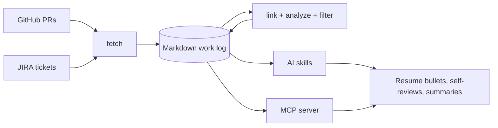

# work-chronicler

CLI and MCP server that turns your GitHub PRs and JIRA tickets into a searchable
markdown work log for performance reviews and resumes.

[](https://www.npmjs.com/package/work-chronicler)
[](LICENSE)

Review season arrives and you have to reconstruct a year of work from memory.
`work-chronicler` pulls what you already wrote down (PR descriptions and ticket
history) into plain markdown files on your machine, then gives AI assistants
structured access to it.

## How it works

Data flows one way: fetch from the sources, enrich locally, then read it with
AI skills or the MCP server.



Each PR becomes one file at
`work-log/pull-requests/<org>/<repo>/<date>_<number>.md`. This example (invented
data) shows a PR after `link` and `analyze --tag-prs` filled in `jiraTickets`
and `impact`:

```markdown
---
title: "feat(billing): add usage-based invoice line items"
prNumber: 1482
repository: billing-service
org: acme
author: jdoe
state: merged
createdAt: 2026-03-04T17:22:10Z
mergedAt: 2026-03-06T15:41:02Z
closedAt: 2026-03-06T15:41:02Z
url: https://github.com/acme/billing-service/pull/1482
additions: 612
deletions: 148
changedFiles: 19
jiraTickets:
  - BILL-311
labels:
  - billing
impact: flagship
---

## Summary

Adds metered line items to monthly invoices so usage-plan customers see
per-feature charges. Replaces the flat overage fee.
```

## Quick start

Requires Node.js 22.22.1 or later (24 recommended), a GitHub personal access token and, optionally,
a JIRA API token.

```bash
npm install -g work-chronicler

work-chronicler init            # guided setup: profile, sources, repos, tokens
work-chronicler fetch all       # fetch PRs and tickets, then link them
work-chronicler status          # see what was fetched
work-chronicler analyze --all   # tag impact, detect projects, build a timeline
work-chronicler skills install  # add the AI skills to Claude Code, Cursor, Codex or Gemini
```

Then, in your AI coding assistant, run a skill such as
`/work-chronicler-write-self-review`. Skills are assistant slash commands; they
do not run in a terminal.

Data lives in `~/.work-chronicler/profiles/<profile>/`. Each profile has its own
`config.yaml`, `.env` (tokens, mode `600`) and `work-log/`. Set
`WORK_CHRONICLER_HOME` to use another root.

## What you can do

| Goal | Use |
| --- | --- |
| Pull PRs and tickets into markdown | `fetch github`, `fetch jira`, `fetch all` |
| Record the PR reviews you gave | `fetch github --reviews` or `fetch all --reviews` |
| Store records a skill gathered from another service | `validate <dir>`, then `import <dir>` |
| Connect PRs to the tickets they reference | `link` (run automatically by `fetch all`) |
| Classify PRs as minor, standard, major or flagship | `analyze --tag-prs` |
| Group related work into projects and a timeline | `analyze --projects --timeline` |
| Keep only the work that matters for a review | `filter` (for example `--min-impact major --merged-only`) |
| Draft resume bullets, self-reviews and summaries | AI skills (`skills install`) |
| Let an assistant query your history | `mcp` (stdio MCP server) |
| Keep work and personal history apart | profiles (`profile list\|switch\|delete`, global `--profile`) |
| Track direct reports as a manager | manager mode (`init --mode manager`, `reports ...`) |

The [command reference](documentation/commands.md) lists every command and flag.

## Scope

What exists today:

- **Sources:** GitHub pull requests you authored (by org and repo, or every
  repo in an org), optionally the reviews and inline review comments you gave
  on other people's PRs in those orgs (IC profiles), and JIRA Cloud tickets
  assigned to you (one or more instances and projects). No other sources are
  fetched.
- **Imported records:** `import` checks a batch of message records that a
  skill staged in a directory and stores it in the work log all or nothing.
  The CLI never contacts the service the records came from.
- **Local enrichment:** PR-to-ticket linking, impact classification, project
  detection from shared ticket references, a week/month timeline, and filtered
  subsets. None of these call an AI model.
- **IC and manager modes:** an individual work log per profile, or per-report
  work logs plus team-level project and timeline rollups for people managers.
- **MCP server:** eight read-only query tools over the work log.
- **AI skills:** ten skills (six for IC profiles, one peer-review skill for
  any profile, three manager-only) that read the work log and write documents
  to the profile's `outputs/` directory.

The CLI itself never calls an LLM; writing happens in your assistant through
the skills or the MCP server.

## Documentation

Start at the [documentation index](documentation/index.md):

- [Configuration](documentation/configuration.md): profiles, `config.yaml`,
  tokens, environment variables and the workspace layout.
- [Command reference](documentation/commands.md): every command and flag.
- [MCP server](documentation/mcp-server.md): client setup and the available tools.
- [AI skills](documentation/available-skills.md): what each skill does and how
  skills find your data.
- [Manager mode](documentation/manager-mode.md): tracking reports and team analysis.

## Development

```bash
pnpm install
pnpm build
pnpm test
```

Run the CLI from source with `pnpm cli <command>`. See
[CONTRIBUTING.md](CONTRIBUTING.md) for checks, commit conventions and the
release process, and [CHANGELOG.md](CHANGELOG.md) for release history.

## License

[MIT](LICENSE)
