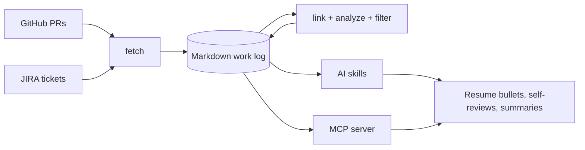

# Work Chronicler

Review season arrives and you have to reconstruct a year of work from memory.
`work-chronicler` pulls what you already wrote down (PR descriptions and ticket
history) into plain markdown files on your machine, then gives AI assistants
structured access to it. It can also store your own Slack messages and the
Google Docs you own as supplementary evidence. The CLI itself never calls an
LLM; writing happens in your assistant through the skills or the MCP server.

These docs are for individual contributors drafting self-reviews, peer reviews
and resumes, and for managers preparing evidence-based reviews for their
reports. New here? Start with [Getting started](getting-started.md).

## Contents

- [Getting started](getting-started.md) - Install, create a profile, fetch and analyze your work, and run a first skill.
- [Workflows](workflows/index.md) - Goal-by-goal guides: resumes and self-reviews, peer reviews, PR reviews you gave, Slack and Google Docs imports, and manager review packets.
- [Tools](tools/index.md) - Reference for every CLI command, the configuration, the MCP server and the AI skills.
- [Contributing](contributing/index.md) - Authoring conventions and checks for these docs.

## How it works

Data flows one way: fetch from the sources, enrich locally, then read it with
AI skills or the MCP server.

Slack messages and Google Docs reach the work log differently: an import skill
reads them (Slack through your assistant's Slack connector, Drive with `gog`)
and hands them to `import`, which checks and stores them. The CLI never
contacts Slack or Google.

## What you can do

| Goal                                                     | Use                                                                  | Guide                                                                        |
| -------------------------------------------------------- | -------------------------------------------------------------------- | ---------------------------------------------------------------------------- |
| Pull PRs and tickets into markdown                       | `fetch github`, `fetch jira`, `fetch all`                            | [Fetch commands](tools/fetch.md)                                             |
| Record the PR reviews you gave                           | `fetch github --reviews` or `fetch all --reviews`                    | [Record the PR reviews you gave](workflows/pr-reviews-given.md)              |
| Store records a skill gathered from another service      | `validate <dir>`, then `import <dir>`                                | [Import and validate](tools/import.md)                                       |
| Import your own Slack messages as supplementary evidence | `/work-chronicler-setup-slack`, then `/work-chronicler-import-slack` | [Import Slack messages](workflows/import-slack.md)                           |
| Import the Google Docs you own as supplementary evidence | `google-docs configure`, then `/work-chronicler-import-google-docs`  | [Import Google Docs](workflows/import-google-docs.md)                        |
| Connect PRs to the tickets they reference                | `link` (run automatically by `fetch all`)                            | [Link, analyze and filter](tools/link-analyze-filter.md)                     |
| Classify PRs and group work into projects and a timeline | `analyze --tag-prs`, `analyze --projects --timeline`                 | [Link, analyze and filter](tools/link-analyze-filter.md)                     |
| Keep only the work that matters for a review             | `filter` (for example `--min-impact major --merged-only`)            | [Link, analyze and filter](tools/link-analyze-filter.md)                     |
| Draft resume bullets, self-reviews and summaries         | AI skills (`skills install`)                                         | [Write resume bullets and self-reviews](workflows/resume-and-self-review.md) |
| Let an assistant query your history                      | `mcp` (stdio MCP server)                                             | [MCP server](tools/mcp-server.md)                                            |
| Keep work and personal history apart                     | profiles (`profile list\|switch\|delete`, global `--profile`)        | [Configuration](tools/configuration.md#profiles)                             |
| Track direct reports as a manager                        | manager mode (`init --mode manager`, `reports ...`)                  | [Manager mode](workflows/manager-mode.md)                                    |

Questions or feedback? Open an issue at
[github.com/tkstang/work-chronicler](https://github.com/tkstang/work-chronicler).
