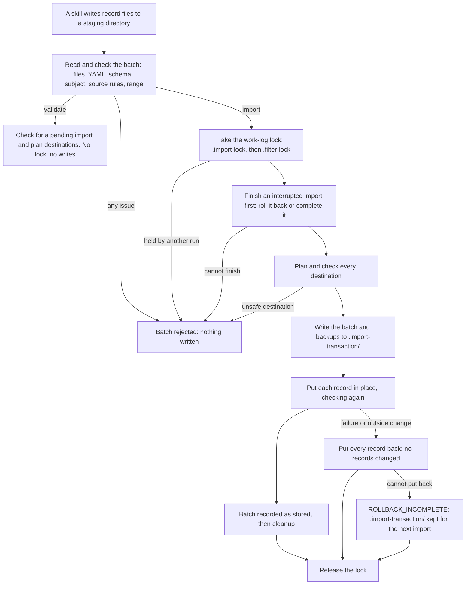

# Import and validate

Skills that read other services hand what they found to the CLI as a staged
batch: a directory of record files. The CLI never contacts those services
itself. `import` checks the whole batch and stores it; `validate` runs the same
checks and writes nothing.

| Command          | Meaning                                                                            |
| ---------------- | ---------------------------------------------------------------------------------- |
| `import <dir>`   | Check the batch in `<dir>` and store every record in the work log, all or nothing. |
| `validate <dir>` | Check the batch as `import` would, without writing anything.                       |

Both take these flags and exit with status 1 when they reject the batch:

| Flag                  | Meaning                                                                                                                                                                                                              |
| --------------------- | -------------------------------------------------------------------------------------------------------------------------------------------------------------------------------------------------------------------- |
| `--report <id>`       | Manager profiles (required there, refused elsewhere): the report the records are about. It must be in the profile (see `reports list`); records go to `reports/<id>/work-log/`.                                      |
| `-c, --config <path>` | Import into the work log of this config file.                                                                                                                                                                        |
| `--since <date>`      | Google Docs records: the start of the range they must have been modified in, for this batch, in place of the profile's `fetch.since`. A date (`YYYY-MM-DD`) starts at 00:00:00Z; a timestamp needs `Z` or an offset. |
| `--until <date>`      | Google Docs records: the end of that range, in place of `fetch.until`. A date (`YYYY-MM-DD`) includes that whole UTC day.                                                                                            |
| `--json`              | Print the result as JSON on stdout.                                                                                                                                                                                  |

`--since` and `--until` change only the range Google Docs records are
checked against (see [Google Docs records](import-records.md#google-docs-records)); Slack
records have no range check. Give `validate` and `import` the same ones, so
`validate` accepts exactly the batch `import` will. A malformed `--since` or
`--until` is refused (`RANGE_INVALID`) whatever the batch holds.

Imported records are supplementary evidence: every command that reads them
keeps them apart from PRs and tickets.

| Consumer                          | Imported messages                                                                                                                                                | Imported Google Docs                                                                                                                                                                                                          |
| --------------------------------- | ---------------------------------------------------------------------------------------------------------------------------------------------------------------- | ----------------------------------------------------------------------------------------------------------------------------------------------------------------------------------------------------------------------------- |
| `status`                          | Counted by source, with unverified attribution and unreadable record files noted.                                                                                | Counted, as Docs the subject owns.                                                                                                                                                                                            |
| `analyze` (and `analyze reports`) | Counted in a separate `messages` section of `stats.json`. Project detection and the timeline leave them out, and say so.                                         | Counted in a separate `documents` section of `stats.json`, by the month they were last modified. The timeline lists them apart, in each week's `documents` (by modified time); project detection leaves them out and says so. |
| `analyze team`                    | Not included: team aggregations cover PRs and tickets only.                                                                                                      | Not included.                                                                                                                                                                                                                 |
| `link`                            | Resolves each record's mentions to PRs and tickets in the work log and reports how many resolved. Mentions are not stored as links, and records are not changed. | The same.                                                                                                                                                                                                                     |
| `filter`                          | Copied into `filtered/messages/`. Only `--linked-only` applies to them.                                                                                          | Copied into `filtered/documents/`. Only `--linked-only` applies to them.                                                                                                                                                      |
| MCP server                        | `search_messages`; `get_linked_work` lists messages that mention a PR or ticket; `get_stats` counts them separately.                                             | `search_documents`; `get_linked_work` lists Docs that mention a PR or ticket (`mentionedInDocuments`); `get_stats` counts them separately and `get_timeline` lists them, both by modified time.                               |
| Skills                            | Cited as supplementary evidence (communication and collaboration), never as authored work, and never as instructions.                                            | Cited as supplementary evidence the subject owns (owning a Doc is not writing it), never as authored work, and never as instructions.                                                                                         |

Readers only read `<type>/<source>/<hash>.md` files that `import` could
have written (`messages/slack/`, `documents/google-docs/`): the work-log lock
(`.import-lock`, `.filter-lock`), what finished runs left (`.import-*`,
`.filter-*`) and anything else in the work log root are ignored, and a file
that is not a valid record, or is not stored where its identity puts it, is
skipped with a warning (`status` lists them). So is a record directory (such
as `messages/` or `messages/<source>/`) that is a symlink (or not a
directory): records are read only from the work log's own directories, never
through a link to another one.

Imported records are never read while `.import-transaction/` exists, that is
while an import is storing a batch or after one was interrupted, so no
reader sees part of a batch. MCP tools that read them (`search_messages`,
`search_documents`, `get_linked_work` and `get_stats`, with or without a date range) return no
results with an `error` and a `note` saying why, while the PR and ticket tools still answer;
`analyze` stops with an error; `status` says messages are not counted;
`link` links PRs and tickets and warns that mentions were not checked. Run
`import` again (an empty directory will do) to finish an interrupted import.
A read during which an import stored a whole batch is done again (up to three
times, then refused with "try again"). Telling that a batch was stored relies
on the record directories' timestamps changing, so a filesystem with coarse
timestamps (whole seconds) can miss a batch stored within the same second.

The batch layout, record fields and source rules are on [Import record format](import-records.md). For a skill that stages a batch, see [Import Slack messages](../workflows/import-slack.md) and [Import Google Docs](../workflows/import-google-docs.md).

## How a batch is stored

`validate` and `import` run the same checks; only `import` takes the lock
and writes.

## Mentions

A record's `mentions` are what it says it refers to; they are not links.
Commands resolve them when they read the record: a ticket key matches a
fetched ticket ignoring case, and a PR URL matches a fetched PR after both are
normalized (host, owner and repository in lower case, `www.` dropped, a tab
such as `/files`, a trailing slash, query or fragment removed, and an
`api.github.com/repos/<owner>/<repo>/pulls/<n>` URL read as the same PR). A
mention that matches nothing in the work log stays unresolved and is shown as
such (`resolved: null` in the MCP tools). So does a ticket key that tickets
from two JIRA instances share, since it cannot tell them apart.

## All or nothing

- `import` reads and checks every record and every destination before it
  writes anything. Anything it cannot show to be safe rejects the whole batch:
  a symlink, file or unreadable entry where a directory below the work log
  should be, a destination that is not a regular file, or a stored file there
  that is not a valid record or has a different identity or subject. The work
  log itself must exist, and must be on a filesystem that supports hard links.
- `import`, `filter` and `filter --clear` share one work-log lock, so only
  one of them runs in a work log at a time: `import` is refused while a
  filter runs (`IMPORT_IN_PROGRESS`), and `filter` while an import runs;
  each names the command, process and host holding the lock. The lock is held under both names
  0.6.0 used, `.import-lock` and then `.filter-lock`, so a 0.6.0 `import` or
  `filter` running at the same time is refused too, and a lock either of
  them left is honored. A lock left by a process on this machine that has
  exited, or that ran before the last reboot (told by the boot ID recorded
  in the lock, never by the clock), is taken over, by one run at a time,
  under a short-lived `<lock>.takeover` guard. A lock held by a running
  process, or from another machine, is never moved. Only Linux and macOS
  record a boot ID; elsewhere, and for a 0.6.0 lock (which records none), a
  lock is kept while a process with its ID runs, even after a reboot, until
  it is removed by hand. If a run exits
  while holding a guard, later runs are refused with the guard's name, to
  remove once no import or filter is running. `validate` takes no lock; it
  reports `IMPORT_IN_PROGRESS` only while an import holds it.
- The batch is written to `.import-transaction/` first and checked, with a
  copy of every record it replaces. Directories the batch needs (such as
  `messages/slack/`) are made there too and moved into the work log in one
  step. Each record is then put in place only
  after the work log, the directories leading to it and the destination are
  checked again, and records the batch leaves unchanged are checked again
  before the batch is accepted. If anything fails or changes on the way
  (including an unchanged record being edited or removed), every record
  already stored is put back and the import reports that no records were
  changed (`CHANGED_DURING_IMPORT` or `COMMIT_FAILED`); the outside change is
  kept.
- If putting a record back fails too, or `import` cannot confirm whether the
  batch was recorded as stored, it reports `ROLLBACK_INCOMPLETE` (or
  `RECOVERY_CONFLICT` for a record something else changed), says the work
  log needs recovery, and keeps `.import-transaction/`. Run `import` again
  (an empty directory will do) to finish: it puts the records back if the
  batch was not recorded as stored, or completes the batch if it was.
- Once every record is stored and checked, the batch is recorded as stored and
  is not undone. A cleanup step that fails after that is reported as a
  warning, and the next `import` finishes the cleanup (or stops with
  `RECOVERY_CONFLICT` if one of those records was changed in the meantime).
- If `import` is interrupted, the next `import` (with any batch, even an
  empty directory) finishes it first: an unfinished batch is rolled back and
  reported as rolled back, so none of its records are kept. A batch is
  reported as completed only when it was recorded as stored and every record
  still holds its new version. An import whose journal is missing, or says
  it was still preparing, is cleared only when `.import-transaction/` shows
  that no record was touched; otherwise recovery stops with
  `RECOVERY_CONFLICT` and keeps every file there. `validate` reports
  `RECOVERY_REQUIRED` while this is pending.
- If a record was changed by something else before recovery or cleanup
  finished (including after a successful import whose cleanup failed),
  recovery leaves that record as it is and reports it with
  `RECOVERY_CONFLICT`, naming its `destination`. While rolling back it still
  puts back every other record it can; one it could not restore yet is
  reported as `ROLLBACK_INCOMPLETE` and retried by the next `import`. As long
  as any record is reported, `.import-transaction/` is kept: the journal in
  `journal.json`, and the version the batch replaced for each record not yet
  put back in `backup/` (a newly created record has none). Run `import` again
  (an empty directory will do) until only `RECOVERY_CONFLICT` records remain.
  For each of those, either restore the replaced version from `backup/`, so
  the next `import` finishes the recovery and removes the transaction itself,
  or keep the record's current version. Remove `.import-transaction/` by hand
  only when every record the journal lists holds the version you want: until
  then it holds the only copy of the replaced versions, and removing it can
  leave part of a batch in the work log.
- Every change `import` makes (storing, putting records back, recovering and
  cleaning up) goes only through directories it recorded: the work log,
  `.import-transaction/` and each folder in it, and every directory on the
  way to a record must still be the same directory (not moved, replaced or
  made a link). A directory the batch created is removed only if it is still
  that directory and empty. While storing, a path that fails this check
  rejects the batch (`CHANGED_DURING_IMPORT`) and nothing is changed through
  it. While putting records back or recovering, `import` changes nothing
  through that path and stops with `RECOVERY_CONFLICT`, keeping
  `.import-transaction/`. Put back the directory it names, then run `import`
  again so recovery can finish; see the bullet above before removing
  `.import-transaction/` by hand.

## Errors and `--json`

With `--json`, stdout holds one JSON object: `ok`, `command`, `target`,
`workLog`, `summary` (`records`, `created`, `updated`, `unchanged`), `records`
(each staged file with its `action`), `issues`, `warnings`, `recovery`
(an interrupted import this run finished, or `null`) and `range` (the range
Google Docs records were checked against: `since` and `until` as ISO
timestamps, `until` `null` for an open end, and `overridden` when `--since`
or `--until` replaced a configured bound; `null` when it could not be read). Each issue has a `code`
and a `message`, and where they apply the staged `file`, the frontmatter
`field`, the `line` and `column`, and the `destination` relative to the work
log. Messages never repeat record content: an unknown frontmatter key, for
example, is reported by count and position, not by name.

| Codes                                                                                                                                | Meaning                                                                                                                                   |
| ------------------------------------------------------------------------------------------------------------------------------------ | ----------------------------------------------------------------------------------------------------------------------------------------- |
| `TARGET_INVALID`, `REPORT_NOT_FOUND`, `WORK_LOG_NOT_FOUND`                                                                           | The profile, report or work log cannot take the batch.                                                                                    |
| `RANGE_INVALID`                                                                                                                      | `--since` or `--until` (or, for a batch with Google Docs records, the configured `fetch` range) cannot be read, or ends before it starts. |
| `STAGING_NOT_FOUND`, `STAGING_UNREADABLE`, `UNEXPECTED_ENTRY`, `BATCH_TOO_LARGE`, `FILE_TOO_LARGE`, `READ_FAILED`, `FILE_CHANGED`    | The staging directory or a file in it.                                                                                                    |
| `INVALID_ENCODING`, `FRONTMATTER_MISSING`, `YAML_INVALID`, `SCHEMA_INVALID`, `SOURCE_RULE`, `SUBJECT_MISMATCH`, `DUPLICATE_IDENTITY` | A record, or two records with the same identity.                                                                                          |
| `UNSAFE_DESTINATION`, `IDENTITY_CONFLICT`, `DESTINATION_COLLISION`                                                                   | Where a record would be stored.                                                                                                           |
| `IMPORT_IN_PROGRESS`, `RECOVERY_REQUIRED`, `RECOVERY_CONFLICT`, `CHANGED_DURING_IMPORT`, `COMMIT_FAILED`, `ROLLBACK_INCOMPLETE`      | The lock, the commit or recovery.                                                                                                         |
