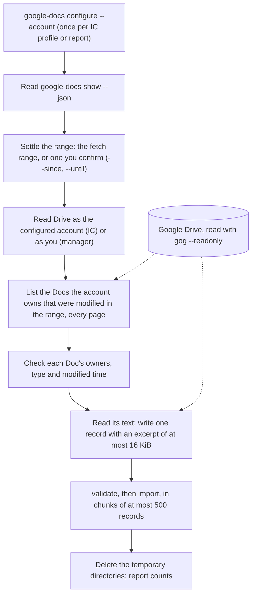

# Import Google Docs

**Skill**: `/work-chronicler-import-google-docs`

The CLI never contacts Google. The skill reads Drive with `gog`, read-only
(`--readonly`): it never edits a Doc, changes sharing or requests access. Set
up the owner account first with `google-docs configure --account <email>`
(see [Google Docs commands](../tools/google-docs.md) and
[Google Docs records](../tools/import-records.md#google-docs-records)).



1. Reads `google-docs show --json` and stops if Google Docs is not set up.
   It imports Docs modified in the profile's fetch range, or in another range
   you confirm in the session (passed to `validate` and `import` as
   `--since`/`--until`).
2. Lists the Google Docs the configured account owns that were modified in
   that range, page by page to the end. In an IC profile it reads as that
   account (`gog --account`); a Doc only shared with you is never yours.
3. Checks each Doc's owners, type and modified time, reads its text, and
   writes one record per Doc with an excerpt of at most 16 KiB of the Doc's
   own text (marked `truncated` when cut), never a summary. Docs it cannot
   read are skipped and counted; empty Docs are counted and not stored.
4. Runs `validate`, then `import`, in chunks of at most 500 records, and
   deletes its temporary directories.
5. Reports counts only (listed, staged, imported, skipped or refused by
   reason), and says the import is incomplete when the listing or a chunk
   failed. Running it again updates the same records and never duplicates
   them.

## For a report

```
work-chronicler google-docs configure --report alice-smith --account alice@example.com
/work-chronicler-import-google-docs alice-smith
```

The skill reads as you, so it sees only the report's Docs that are shared
with you. Records go to `reports/alice-smith/work-log/documents/`.

Google Docs import is opt-in per report too: a report without Google Docs
settings contributes no Google Docs records. The settings name the report's
own Google account, the owner every imported Doc must have. The import skill
reads Drive as you (the manager), so it can only find Docs the report owns
and shared with you, and it never changes sharing. `import` refuses a Doc
owned by anyone else, and a Doc for a report without settings.

```bash
work-chronicler google-docs configure --report alice-smith \
  --account alice@example.com
work-chronicler google-docs show --report alice-smith --json
```

The same rules as for an IC apply: only Google Docs (not other Drive files)
the report owns, outside shared drives, modified inside the profile's fetch
range or another range you confirm when the skill asks (passed to `validate`
and `import` as `--since`/`--until`), so you do not need to change the profile's
fetch range. See [Google Docs commands](../tools/google-docs.md). Then run
`/work-chronicler-import-google-docs alice-smith` to import them.

## Settings reference

- [Google Docs commands](../tools/google-docs.md): `google-docs configure` and `google-docs show`.
- [Google Docs configuration](../tools/configuration.md#google-docs): the `googleDocs` field in `config.yaml`.
- [Google Docs records](../tools/import-records.md#google-docs-records): what `import` refuses.
