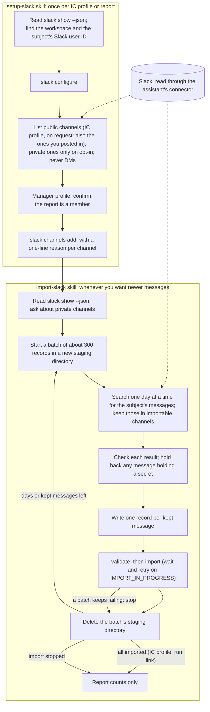

# Import Slack messages

**Skills**: `/work-chronicler-setup-slack`, then `/work-chronicler-import-slack`

The CLI never contacts Slack. These skills read Slack through your
assistant's Slack connector, read-only: they never post, react or change
anything there. The CLI stores the settings and checks every record on import
(see [Slack commands](../tools/slack.md) and [Slack records](../tools/import-records.md#slack-records)).



**Setup** (`/work-chronicler-setup-slack`, once per IC profile or report):

1. Finds the workspace (its team ID if a Slack tool shows one, otherwise its
   URL label from a permalink, such as `example` for `example.slack.com`)
   and the subject's Slack user ID, and runs `slack configure`.
2. Lists your public channels and asks which hold review-relevant work.
   If you ask for the channels you posted in, it finds them by searching
   your own messages (the channel list leaves out archived channels and
   ones you left). Private channels are offered only if you opt in; direct
   messages and group DMs never are.
3. In a manager profile, offers only channels you share with the report: it
   checks the report is a member before passing `--shared-with-manager`.
4. Records a one-line reason per channel with `slack channels add`.

**Import** (`/work-chronicler-import-slack`):

1. Reads `slack show --json` and stops if Slack is not set up.
2. Searches one day at a time for messages the subject wrote in the
   profile's fetch range (private channels only with your consent, each
   searched on its own unless you allow a search of all of them), without
   reading threads or other people's replies, and keeps only those from
   importable channels. A day with more results than one Slack search
   returns (400) is searched again channel by channel.
3. Writes one record per message (the subject's own text; a reply keeps only
   its parent's ID and link) in batches of a few hundred, each in a new
   temporary staging directory: it runs `validate`, then `import`, and
   deletes the directory before the next batch. If a batch keeps failing,
   it stops and reports the days it did not import. A message holding a
   password, key, token or other secret is held back and counted, not
   staged in this run. An earlier import may already have stored such a
   message: an import never removes records.
4. Reports counts only. Running it again updates the same records and never
   duplicates them.

## For a report

```
/work-chronicler-setup-slack alice-smith
/work-chronicler-import-slack alice-smith
```

Only channels you and the report both belong to are used, and records go to
`reports/alice-smith/work-log/messages/`.

Slack import is opt-in per report: a report without Slack settings
contributes no Slack records. Only channels that you (the manager) and the
report both belong to may be used. The CLI cannot see Slack, so the setup
skill (`/work-chronicler-setup-slack`) checks membership through your Slack
connector, and you confirm it for each channel with `--shared-with-manager`;
the CLI refuses a report channel without that confirmation, and `import`
refuses records from a channel that lacks it. `/work-chronicler-import-slack`
then imports the report's own messages from those channels. Run both skills
with the report ID, for example `/work-chronicler-setup-slack alice-smith`.

```bash
work-chronicler slack configure --report alice-smith \
  --workspace T0EXAMPLE --user U0EXAMPLE2
work-chronicler slack channels add C0EXAMPLE --report alice-smith \
  --name billing-launch --reason "Launch coordination" --shared-with-manager
work-chronicler slack show --report alice-smith --json
```

The same rules as for an IC apply: only the report's own messages, public
channels unless `--private` opts one in, never direct messages. See
[Slack commands](../tools/slack.md).

## Settings reference

- [Slack commands](../tools/slack.md): `slack configure`, `slack channels` and `slack show`.
- [Slack configuration](../tools/configuration.md#slack): the `slack` fields in `config.yaml`.
- [Slack records](../tools/import-records.md#slack-records): what `import` refuses.
