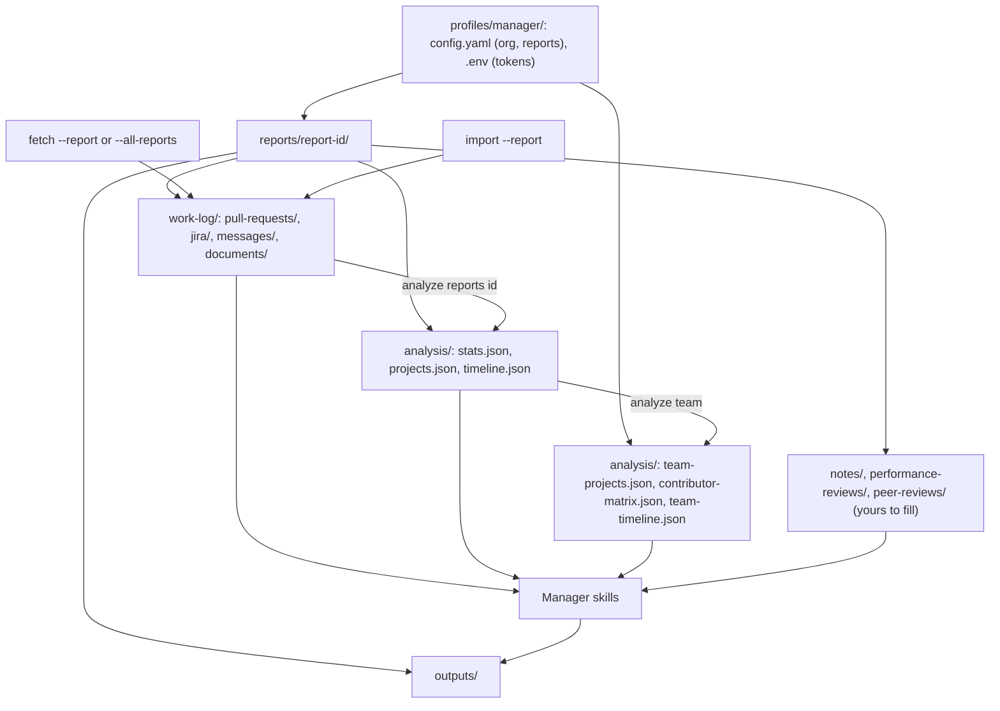

# Manager mode

Manager mode enables people managers to track work across multiple reports, making performance review preparation and team visibility significantly easier.

## Overview

### What is Manager Mode?

Manager mode extends work-chronicler to support people managers who need to:

- Track work across multiple direct reports
- Prepare evidence-based performance reviews
- Maintain team visibility and project awareness
- Generate quarterly rollups and team summaries

Unlike individual contributor (IC) mode where you track your own work, manager mode lets you collect, analyze, and summarize work for your entire team.

### Who is it for?

- **Engineering managers** preparing quarterly performance reviews
- **Tech leads** tracking team contributions across projects
- **Directors** needing team-level visibility
- Anyone managing 2+ engineers who wants automated evidence collection

### Key Features

- **Per-report workspaces**: Each direct report gets isolated data collection (PRs, tickets, notes)
- **Automated discovery**: Auto-discover repos where each person contributed
- **Dual-layer analysis**: Individual analysis per report + team-level aggregations
- **Review packet generation**: AI skills generate evidence-based review content
- **Context-rich**: Include past reviews and notes for consistency

---

## Setup

### Creating a Manager Profile

Initialize work-chronicler with manager mode:

```bash
# Interactive setup (recommended)
work-chronicler init --mode manager

# This will guide you through:
# 1. Naming the profile (default "manager"; any name works)
# 2. Configuring GitHub org and token
# 3. Optionally configuring Jira
# 4. Adding your first reports
```

**Example interactive flow:**

```
Creating manager profile...
✓ Profile 'manager' created

GitHub Configuration:
? GitHub organization: acme-corp
? GitHub token: ghp_******************** (input hidden)

Jira Configuration (optional):
? Configure Jira? Yes
? Jira host: acme.atlassian.net
? Jira email: manager@acme.com
? Jira API token: ****************** (input hidden)

✓ Configuration saved

? Would you like to add reports now? Yes
```

### GitHub Token Requirements

Create a GitHub personal access token at https://github.com/settings/tokens with:

- **Scope**: `repo` (for private repos) or `public_repo` (for public repos only)
- **Read access** to PRs, commits, and repositories

The manager's token is used to fetch data for all reports.

### Jira Configuration (Optional)

If your team uses Jira:

1. Create an API token at https://id.atlassian.com/manage-profile/security/api-tokens
2. Provide your Jira host (e.g., `company.atlassian.net`)
3. Use your manager email for attribution

### Adding Your First Reports

During `init`, you can add reports interactively:

```
Report 1:
  Name: Alice Smith
  GitHub username: alice
  Email: alice@acme.com

  Repos: [Auto-discover] [Specify manually] [Skip for now]
  → Auto-discover

  Discovering repos for alice in acme-corp...
  ✓ Found 12 repos with contributions

  Jira projects (comma-separated, optional): PLAT, AUTH

✓ Alice Smith (alice-smith) added

? Add another report? Yes
```

**Or skip and add later:**

```bash
work-chronicler reports add
```

## Managing Reports

### Adding Reports

**Interactive mode** (recommended for first-time setup):

```bash
work-chronicler reports add
```

This prompts for:

- Name (e.g., "Alice Smith")
- GitHub username (e.g., "alice")
- Email (e.g., "alice@acme.com")
- Repo discovery method:
  - **Auto-discover**: Scan org for repos where this person contributed
  - **Specify manually**: Enter comma-separated repo list
  - **Skip for now**: Add repos later
- Jira projects (comma-separated, optional)

**Non-interactive mode** (for scripting):

```bash
work-chronicler reports add "Alice Smith" \
  --github alice \
  --email alice@acme.com \
  --repos frontend,backend,infra \
  --jira-projects PLAT,AUTH
```

The optional `[name]` argument is the display name (the report ID is derived from it, e.g. `alice-smith`). The command only runs non-interactively when both `--github` and `--email` are given; otherwise it prompts. Repo auto-discovery is available only in the interactive prompts (choose **Auto-discover**).

### Listing Reports

View all configured reports:

```bash
work-chronicler reports list
```

**Example output:**

```
Manager profile: manager
Org: acme-corp

Reports (3):
  1. Alice Smith (alice-smith)
     GitHub: alice | Email: alice@acme.com
     Repos: 12 | Jira Projects: 2
     Last fetch: 2/1/2026, 10:30:00 AM

  2. Bob Jones (bob-jones)
     GitHub: bjones | Email: bob.jones@acme.com
     Repos: 8 | Jira Projects: 1
     Last fetch: 2/3/2026, 2:15:00 PM

  3. Charlie Davis (charlie-davis)
     GitHub: cdavis | Email: charlie@acme.com
     Repos: 5 | Jira Projects: 0
```

Each report shows its repo and JIRA project counts. A "Last fetch" line (in
your locale's date format) appears only once the report has been fetched.

### Updating Reports

Modify repos or projects for existing reports:

```bash
# Add a repository
work-chronicler reports update alice-smith --add-repo new-service

# Remove a repository
work-chronicler reports update alice-smith --remove-repo old-repo

# Add Jira project
work-chronicler reports update bob-jones --add-jira-project FRONTEND

# Remove Jira project
work-chronicler reports update bob-jones --remove-jira-project LEGACY
```

### Removing Reports

Remove a report with optional data deletion:

**Interactive** (prompts for data deletion choice):

```bash
work-chronicler reports remove alice-smith
```

**Output:**

```
? What should we do with alice-smith's data?
  ◯ Keep data (remove from config only)
  ◉ Delete data (remove config + delete all work-log/analysis/outputs)

⚠️  Deleting data is permanent and cannot be undone.
```

**Non-interactive:**

```bash
# Keep data in filesystem, remove from config
work-chronicler reports remove alice-smith --keep-data

# Delete everything (config + all data)
work-chronicler reports remove alice-smith --delete-data
```

## Fetching Data

All fetch commands (`github`, `jira`, `all`) support three modes in manager mode:

- **Interactive**: Prompts for report selection when no flags provided
- **Single report**: `--report <id>` to fetch for one report
- **All reports**: `--all-reports` to fetch for all reports

**Important**: Reports are fetched with the manager's tokens. GitHub requests use
the manager's GitHub token and fetch PRs authored by the report's GitHub
username. JIRA requests use the manager's JIRA API token with the report's
email as the account email, and fetch tickets assigned to that account in the
report's JIRA projects.

### Fetch All Reports

Fetch data for all reports at once:

```bash
# Interactive (prompts for report selection)
work-chronicler fetch all

# Non-interactive (fetch all reports)
work-chronicler fetch all --all-reports

# Also works with github and jira commands
work-chronicler fetch github --all-reports
work-chronicler fetch jira --all-reports
```

**Example output:**

```
Fetching data for all reports...

Fetching data for Alice Smith (1/3)...
  ✓ Found 12 repos
  Fetching GitHub PRs... 45/120 (37%)
  Fetching Jira tickets... 12/30 (40%)
✓ Alice Smith complete (2m 15s)

Fetching data for Bob Jones (2/3)...
  ✓ Found 8 repos
  Fetching GitHub PRs... 23/80 (28%)
  Fetching Jira tickets... 8/20 (40%)
✓ Bob Jones complete (1m 45s)

Fetching data for Charlie Davis (3/3)...
  ✓ Found 5 repos
  Fetching GitHub PRs... 12/50 (24%)
✓ Charlie Davis complete (1m 10s)

Summary:
✓ 3/3 reports completed
  Total PRs: 80
  Total tickets: 20
  Time: 5m 10s
```

### Fetch Individual Report

Fetch data for a specific report:

```bash
# Interactive selection (any fetch command)
work-chronicler fetch all
work-chronicler fetch github
work-chronicler fetch jira

? Which report(s)?
  ◯ Alice Smith (alice-smith)
  ◯ Bob Jones (bob-jones)
  ◯ Charlie Davis (charlie-davis)
  ◉ All reports

# Or specify directly
work-chronicler fetch all --report alice-smith
work-chronicler fetch github --report bob-jones
work-chronicler fetch jira --report charlie-davis
```

### Cache Mode

Use `--cache` to skip already-fetched items:

```bash
# Works with any fetch command
work-chronicler fetch all --all-reports --cache
work-chronicler fetch github --report alice-smith --cache
```

This is useful for incremental updates - only new PRs and tickets are fetched.

### Importing Records for a Report

Records staged by an import skill go into one report's work log with
`--report`. Every record must name that report as its subject, and the report
must be in the profile:

```bash
work-chronicler validate ./staged-batch --report alice-smith
work-chronicler import ./staged-batch --report alice-smith
```

See [Import and validate](../tools/import.md) for the record format and how a batch is
stored all or nothing. `analyze reports <id>` counts a report's imported
messages and imported Google Docs in separate `messages` and `documents`
sections of its `stats.json`; its timeline lists the Docs apart by modified
time, and project detection and `analyze team` cover PRs and tickets only. The
manager skills cite messages and imported Google Docs as supplementary
evidence, never as PRs or tickets, and describe a Doc as one the report owns,
never as one they wrote.

Slack messages and Google Docs for a report need their own settings first;
see [Import Slack messages](import-slack.md#for-a-report) and
[Import Google Docs](import-google-docs.md#for-a-report).

## Directory Structure

How the commands fill a manager profile (the default profile name is
`manager`):



Manager mode uses a specialized directory structure:

```
~/.work-chronicler/
└── profiles/
    └── manager/                    # Manager profile
        ├── config.yaml              # Manager config (GitHub org, reports list)
        ├── .env                     # Tokens (GitHub, Jira)
        ├── reports/                 # Per-report workspaces
        │   ├── alice-smith/
        │   │   ├── work-log/
        │   │   │   ├── pull-requests/
        │   │   │   │   └── acme-corp/
        │   │   │   │       ├── frontend/
        │   │   │   │       │   ├── 2024-01-15_123.md
        │   │   │   │       │   └── 2024-02-20_456.md
        │   │   │   │       └── backend/...
        │   │   │   ├── jira/
        │   │   │   │   └── acme-corp/
        │   │   │   │       ├── PLAT/
        │   │   │   │       │   ├── PLAT-100.md
        │   │   │   │       │   └── PLAT-101.md
        │   │   │   │       └── AUTH/...
        │   │   │   ├── messages/    # Records stored by `import --report alice-smith`
        │   │   │   └── documents/   # Google Docs stored by `import --report alice-smith`
        │   │   ├── analysis/        # Per-report analysis
        │   │   │   ├── stats.json
        │   │   │   ├── projects.json
        │   │   │   └── timeline.json
        │   │   ├── performance-reviews/  # Optional: Past reviews
        │   │   │   └── 2025-q4-review.md
        │   │   ├── peer-reviews/         # Optional: Peer feedback
        │   │   │   └── 2025-q4-peer-feedback.md
        │   │   └── notes/                # Optional: Manager notes
        │   │       └── 2026-goals.md
        │   ├── bob-jones/
        │   │   ├── work-log/...
        │   │   ├── analysis/...
        │   │   ├── performance-reviews/
        │   │   └── notes/
        │   └── charlie-davis/...
        └── analysis/                # Team-level analysis
            ├── team-projects.json
            ├── contributor-matrix.json
            └── team-timeline.json
```

Each report can also hold your own context in `notes/`, `performance-reviews/`
and `peer-reviews/`; see [Add context](review-packets.md#add-context).

## Troubleshooting

### "No reports configured"

**Error**: `Error: No reports configured in manager profile.`

**Solution**: Add reports with `reports add` or re-run `init --mode manager`

### Discovery finds no repos

**Issue**: Auto-discovery returns 0 repos for a report.

**Possible causes**:

- GitHub username is incorrect
- Person hasn't contributed to org repos recently
- Date range is too narrow (the auto-discovery lookback is fixed at 6 months)

**Solution**:

- Verify GitHub username: `reports list`
- Use manual repo specification: `reports update <id> --add-repo <repo>`
- Add repos manually with `reports update` if discovery misses them

### Fetch fails for one report

**Issue**: Fetch succeeds for some reports but fails for others.

**Behavior**: work-chronicler continues with other reports and logs errors. If every repository in the manager org fails to fetch for a report (or the org cannot be listed), it prints a warning naming the org and exits with status 1 after processing the remaining reports.

**Check**:

- Errors: printed to the terminal for each failing repo (no error log file is written)
- Verify report config: `reports list`

**Common causes**:

- Invalid repo names (typos)
- GitHub rate limiting (wait and retry)
- Jira project permissions

## Next steps

- **Analyze and write reviews**: [Review packets and team analysis](review-packets.md)
- **Read more**: See the [command reference](../tools/commands.md) for every CLI flag and the [documentation index](../index.md) for the other guides

**Questions or feedback?** Open an issue at [github.com/tkstang/work-chronicler](https://github.com/tkstang/work-chronicler)
